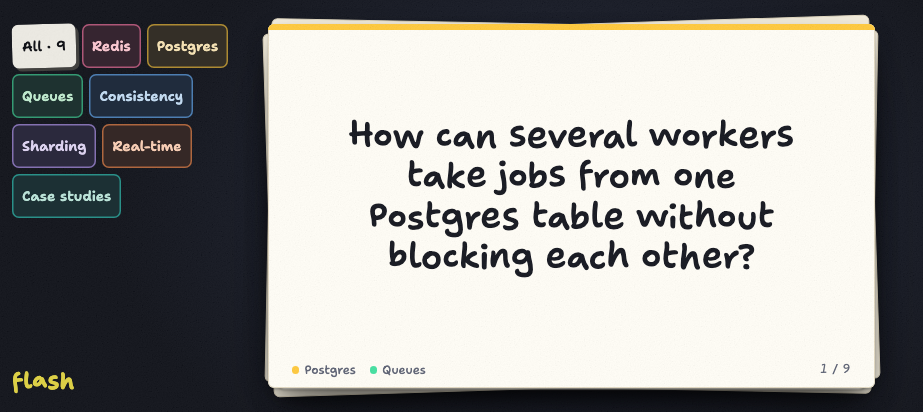
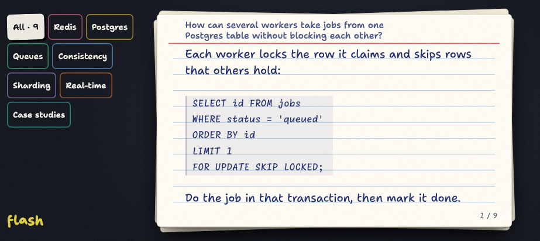

# flash

Flash cards for studying on a phone held sideways: a hand-written index card on a dark desk. Tap the card to turn it over; swipe it away for the next one. The app only reads: the deck is one TOML file, edited in your editor and shipped with one command.

<p align="center">
  
  
</p>

Built for a Pixel 11 in landscape, as an installable web app that works offline. It is one person's study tool, published so it can be forked: there are no accounts, no editing in the app and no plans for either.

## Reading

- **Tap** the card to turn it over, and again to turn it back.
- **Swipe left** for the next card, from either side, so a card can be skipped unread.
- **Swipe right** for the previous one. Every card you land on shows its question first.
- Each pass is a fresh shuffle with no repeats. After the last card, tap or swipe left to shuffle again.
- **Topics**: tap the desk beside the card, then the lower sticker (or press `t`): the topics slide in. Tap topics to narrow the deck; a card shows if it has any selected topic. **All** clears the selection. Tap beside the list to close it. The selection survives closing the app; the place in the pass doesn't.
- The screen stays on while you read, until 5 minutes without a touch.

With a keyboard:

| Key                          | Does                   |
|------------------------------|------------------------|
| Space, Enter, ↑, ↓, `j`, `k` | turn the card over     |
| →, `l`, Page Down            | next card              |
| ←, `h`, Page Up              | previous card          |
| `s`                          | shuffle again          |
| `f`                          | fullscreen, on and off |
| `t`, Escape                  | topics, open and shut  |

## Your deck

The deck is `cards/cards.toml`, which is not in the repository: it is yours. Start from the example:

```sh
cp cards/example.toml cards/cards.toml
```

A card is a question, its topics and an answer, in Markdown with bold, inline code, lists and code blocks:

```toml
topics = ["Redis", "Postgres"]

[[card]]
question = "What does Redis do by default when memory is full?"
topics = ["Redis"]
answer = '''
**Nothing is evicted.** The default policy is `noeviction`: once `maxmemory` is reached, writes fail; reads still work.
- On 64-bit, `maxmemory` defaults to 0 (no limit), so set one.
- For a cache, configure `allkeys-lru` (or `allkeys-lfu`).
'''
```

[docs/cards.md](docs/cards.md) has the format, every rule and how to write a card that fits. `bun run cards:check` lists every problem at once; the server refuses to start on a bad deck, so a broken one never goes live. Keep the file somewhere private (a separate private repository, symlinked in, works well): the address the app is served on is public, whatever `noindex` says.

## Installing it on the phone

1. Open the app's address in Chrome.
2. ⋮ → **Install**. Not "Create shortcut": that only opens it in a tab.
3. Start it from the home screen: fullscreen, in landscape.

Once it has opened twice with a connection, it works offline: the first launch installs the app, the second keeps the deck on the phone. A card change shows the next time the app starts, a code change the time after: the new version installs in the background. Tap the desk beside the card and two stickers appear for a moment: in a browser tab, the corner brackets go fullscreen and, once there, come back out; the lower sticker opens the topics.

## Developing

Needs [Bun](https://bun.sh) 1.3.14, shellcheck and Playwright's Chromium (`bunx playwright install chromium`, once).

```sh
bun install
bun run serve   # the server on :3000, restarting when its code changes
bun run dev     # Vite on :5173, passing /api and /healthz to :3000
```

Run both and open http://localhost:5173. The server reads the deck when it starts: restart `bun run serve` after changing `cards/cards.toml`.

| Command          | Runs                                                                                                     |
|------------------|----------------------------------------------------------------------------------------------------------|
| `bun run test`   | the unit and component tests: Vitest for `src/`, then `bun test` for `server/`, `scripts/` and `shared/` |
| `bun run e2e`    | Playwright, headless: a Pixel 11 in landscape, in portrait, and a laptop; `bun run build` first          |
| `bun run verify` | every gate in order: `cards:check`, `typecheck`, `lint`, `test`, `build`, `budget`, `e2e`                |

Each step of `verify` also runs alone, as `bun run <step>`; `budget` checks the size budgets over `dist/`. `bunx biome check --write .` fixes formatting and import order. The e2e suite serves your deck too, for the fit test: every card must fit both its faces without scrolling.

`CLAUDE.md` is the project brief for [Claude Code](https://claude.com/claude-code), which wrote most of this: every design decision with its reason, the conventions, and the gotchas met on the way. `docs/plan.md` is the spec it was built to.

## Deploying

One small droplet on DigitalOcean: Bun behind Caddy, which gets the certificate. The deploy script needs `doctl` logged in, an SSH key registered with DigitalOcean, a domain whose DNS DigitalOcean serves, and `.env.deploy` in the repo root (copy `.env.deploy.example`).

```sh
scripts/deploy-do.sh up      # verify, then create the droplet if needed, provision, upload, check it's healthy
scripts/deploy-do.sh cards   # the deck alone: check, fit test on the droplet's code, upload, restart, check; never code
scripts/deploy-do.sh link    # print the address
scripts/deploy-do.sh logs    # the server's log
scripts/deploy-do.sh down    # delete the droplet and its DNS record
```

`up` touches nothing on DigitalOcean unless `bun install --frozen-lockfile` and `bun run verify` pass; no flag skips them. The server itself is one file with no dependencies (`bun run build` leaves it at `build/server.js`, the client at `dist/`), so anything that runs Bun can host it:

| Variable | Default            | Is                        |
|----------|--------------------|---------------------------|
| `PORT`   | `3000`             | the port it listens on    |
| `HOST`   | `0.0.0.0`          | the address it listens on |
| `CARDS`  | `cards/cards.toml` | the deck                  |
| `DIST`   | `dist`             | the built app it serves   |

## Layout

```text
cards/example.toml   an example deck; yours goes beside it as cards.toml, untracked
shared/              the wire types, the deck file's schema and limits, the characters the fonts cover
server/              Markdown rendering, loading and checking the deck, the API, the Bun entry point
src/                 the app: deck engine, gestures and motion, stage, card, the desk's controls, the topic drawer
scripts/             cards:check, the size budgets, the icons, the deploy script
tests/               the fixture deck, the Playwright specs and their screenshots, the conventions test
docs/                the plan, the card guide
```

## Credits

Type: [Caveat](https://fonts.google.com/specimen/Caveat) and [Klee One](https://fonts.google.com/specimen/Klee+One) (OFL), [Permanent Marker](https://fonts.google.com/specimen/Permanent+Marker) (Apache 2.0), [Geist and Geist Mono](https://vercel.com/font) (OFL); the licences sit beside the font files in `src/fonts/`. Built with Bun, Hono, Vite, React, TanStack Query, Playwright and Biome.

MIT licensed.
